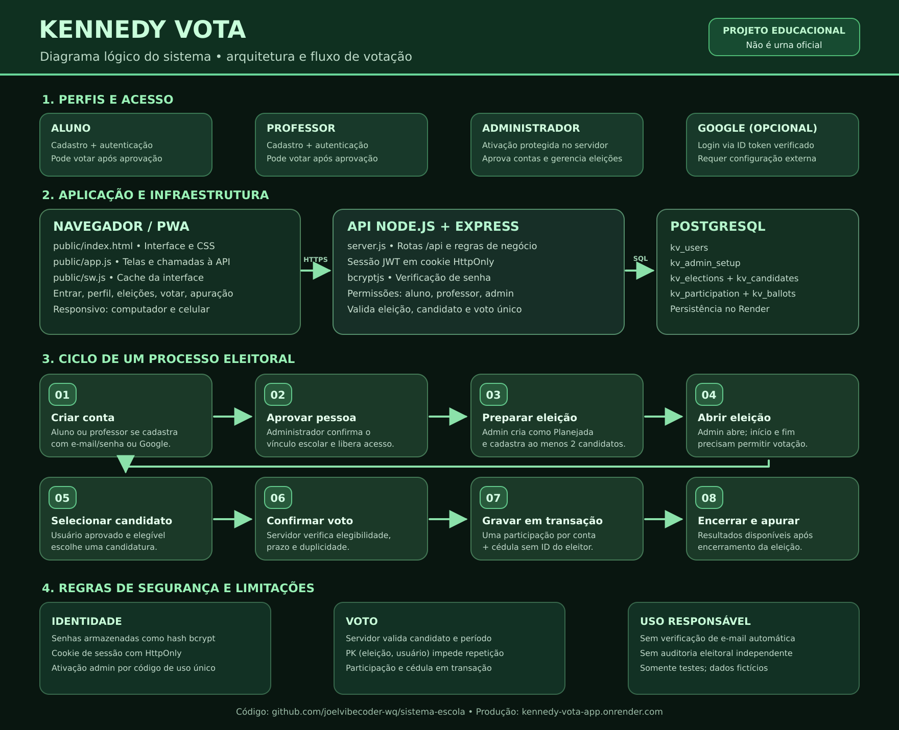

# Eleição Escolar — demonstração educacional

Projeto de simulação eleitoral para aprendizado. Candidatos, participantes, municípios e resultados são fictícios. Não é um sistema oficial nem deve ser usado em eleições reais. Não insira CPF, telefone, e-mail ou outros dados pessoais reais.

## Histórico do projeto

O sistema começou como **Eleitoral Digital** e foi preparado inicialmente para o Netlify. A estrutura original usa arquivos estáticos em `public/`, rotas de backend em `netlify/functions/` para sessão, voto e resultados, e Netlify Blobs para guardar os votos demonstrativos.

Depois, o projeto passou a se chamar **Eleição Escolar** e a hospedagem da interface foi transferida do Netlify para o **Render**. O repositório de publicação é [sistema-escola](https://github.com/joelvibecoder-wq/sistema-escola).

## Estado atual

- **Site publicado:** [https://sistema-escola-p7xy.onrender.com](https://sistema-escola-p7xy.onrender.com)
- **Hospedagem atual:** Render Static Site, publicando a pasta `public/`.
- **Deploy:** automático a partir da branch `main` do GitHub.
- **Interface:** HTML, CSS e JavaScript, responsiva e com recursos PWA (manifest e service worker).
- **CRUD demonstrativo:** cadastro, listagem, pesquisa, edição e exclusão de registros fictícios na área Administração.
- **Armazenamento do CRUD:** `localStorage` do navegador atual. Os registros não sincronizam entre aparelhos e podem ser apagados ao limpar os dados do navegador.
- **Backend original:** Netlify Functions (sessão, voto e apuração) + Netlify Blobs.
- **Migração incompleta:** as APIs e o armazenamento de Netlify ainda não foram migrados para serviços compatíveis com Render. O serviço Render atual é estático e não executa Netlify Functions nem oferece armazenamento persistente de votos por si só.

A proteção contra repetição na versão de origem é por sessão do navegador, não por identidade real. Cookies removidos ou outro navegador podem iniciar uma sessão diferente.

## Fluxograma

## CRUD local demonstrativo

Na área **Administração / CRUD**, é possível criar, consultar, pesquisar, editar e excluir registros de demonstração (nome fictício, turma e data de nascimento fictícia). O conteúdo fica apenas no `localStorage` daquele navegador. Não utilize informações reais. A API e o banco de dados remoto não fazem parte desta atualização.

## Tecnologias

- HTML, CSS e JavaScript
- PWA: `public/manifest.webmanifest` e `public/sw.js`
- GitHub para versionamento e disparo de deploy
- Render Static Site para publicação da interface
- Netlify Functions + Netlify Blobs na implementação original do backend

## Uso responsável

Este é um protótipo educacional com dados inteiramente fictícios. Não utilize para eleições reais, não colete credenciais reais e não cadastre informações pessoais.
