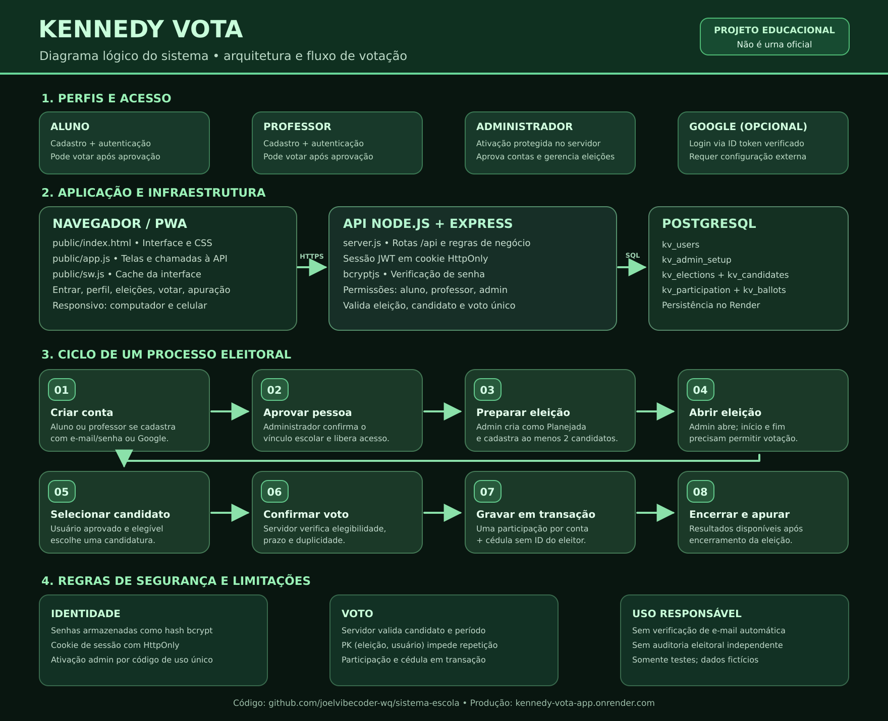
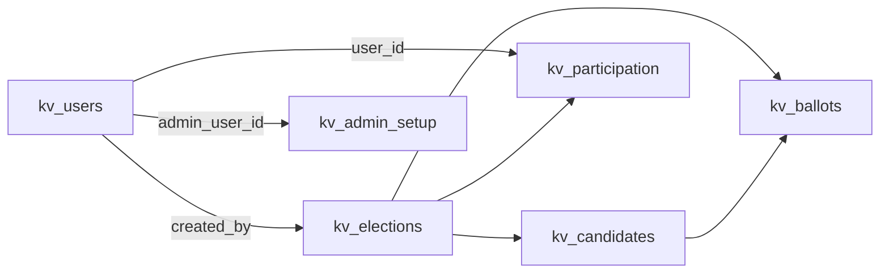

# Arquitetura do Kennedy Vota

[← Voltar ao README](../README.md) · [Diagrama em imagem](diagrama-logico-kennedy-vota.svg) · [Passo a passo](GUIA-DO-PROJETO.md)

> Documento técnico da versão atual na branch de implantação do **Render Web Service Node.js**. O sistema é experimental, não auditado para eleições oficiais.

## 1. Visão geral

**Fluxo:** navegador/PWA → requisição HTTPS com cookie → servidor Express → validação → SQL no PostgreSQL → resposta JSON → atualização da interface.

### Camadas

| Camada | Arquivo | Responsabilidade |
| --- | --- | --- |
| Interface | `public/index.html` | HTML, CSS responsivo, modo claro/escuro, abas, formulários e modais |
| Interação | `public/app.js` | Estado da sessão, requisições `/api`, navegação, renderização e mensagens |
| PWA | `public/manifest.webmanifest`, `public/sw.js` | Instalabilidade e cache de arquivos públicos; **sem voto offline** |
| API | `server.js` | Rotas Express, autenticação, permissões e transações |
| Dados | PostgreSQL `kv_*` | Usuários, eleições, candidatos, participações e cédulas |
| Hospedagem | `render.yaml` | Web Service Node.js, build, start, health check e referência à base existente |

A aplicação atual **não usa React, Bootstrap ou Firebase**. A interface é JavaScript puro, com CSS dentro de `public/index.html`.

## 2. Perfis e autenticação

- **Aluno:** solicita cadastro; precisa aprovação para votar; pode consultar a visão geral após entrar.
- **Professor:** mesmo processo; acesso às eleições cujo público inclui professores.
- **Administrador:** primeira ativação controlada por `ADMIN_SETUP_EMAIL` e `ADMIN_SETUP_TOKEN` (somente no servidor). Depois pode aprovar cadastros, gerenciar eleições e candidaturas. A função de voto do admin aceita somente eleições que incluem o público professor.
- **Google (opcional):** ID token verificado no servidor usando `GOOGLE_CLIENT_ID`; para contas com e-mail já existente, é necessário vincular, não duplicar cadastro.

A sessão usa **JWT com assinatura HS256** em cookie `HttpOnly`, `SameSite=Lax` e, em produção, `Secure`, expiração de **8 horas**. Senhas são verificadas com **bcryptjs**. A API nunca devolve a senha em texto.

**Detalhe importante:** o cadastro com e-mail/senha ainda não comprova por mensagem que a pessoa controla aquele endereço. A escola deve validar identidade e vínculo por procedimento próprio antes de aprovar. Ver [segurança](SEGURANCA.md).

## 3. Dados e relacionamentos

As tabelas `kv_*` são inicializadas pelo `server.js` durante a subida do serviço; o SQL dentro de `db/` é material de referência e pode não refletir migrações recentes.

| Tabela | Dados principais | Relação |
| --- | --- | --- |
| `kv_users` | `id`, `email`, `full_name`, `password_hash`, `google_sub`, `requested_role`, `role`, `approved`, `age_years` | Conta e papel (idade opcional) |
| `kv_admin_setup` | `singleton`, `admin_user_id`, `activated_at` | Registra primeira ativação administrativa |
| `kv_elections` | `id`, `title`, `kind`, `description`, `status`, `starts_at`, `ends_at`, `eligible_roles`, `created_by` | Eleição e criador |
| `kv_candidates` | `id`, `election_id`, `number`, `name`, `office`, `proposals` | Candidatos de uma eleição |
| `kv_participation` | `election_id`, `user_id` | **Chave primária composta**, impede segundo voto da mesma conta |
| `kv_ballots` | `id`, `election_id`, `candidate_id` | Cédula da eleição, sem e-mail/ID direto do eleitor |

O sistema grava a participação e a cédula **na mesma transação**. As tabelas separadas reduzem a ligação direta eleitor→candidato, porém outros riscos de correlação e falhas operacionais exigem auditoria.

## 4. Etapas de uma eleição

1. **Planejada:** admin cria o processo com datas válidas e papéis elegíveis.
2. **Candidaturas:** enquanto Planejada, admin cadastra ao menos dois candidatos.
3. **Aberta:** admin clica em **Abrir**. O serviço só permite abrir se houver ao menos dois candidatos e uma data final futura.
4. **Dentro do intervalo:** a votação só aparece quando `starts_at ≤ agora < ends_at` e o status é Aberta.
5. **Eleitor elegível:** deve estar logado, aprovado e ter papel compatível. Admin é elegível apenas quando a eleição aceita professores.
6. **Confirmação:** API valida eleição, candidato, prazo e vínculo; então grava `kv_participation` + `kv_ballots` na mesma transação.
7. **Encerramento:** admin encerra manualmente ou o relógio ultrapassa `ends_at`; resultados ficam acessíveis após o período ou quando status é Encerrada.
8. **Exclusão administrativa opcional:** o administrador pode selecionar uma eleição Planejada, Aberta ou Encerrada e escolher **Excluir**. Após digitar `EXCLUIR`, o servidor exige também o título exato e apaga, em transação, suas cédulas, participações, candidaturas e o processo. **A ação é irreversível e os resultados são perdidos.** Exporte a apuração antes da exclusão caso precise preservá-la.

**Não existe opção de voto duplicado, troca de voto nem reabertura automática.**

## 5. Rotas principais da API

| Método e rota | Função | Requisito |
| --- | --- | --- |
| `GET /api/status` | Saúde do banco e API | Público |
| `GET /api/config` | Configuração pública (sem segredo) | Público |
| `POST /api/register` | Cadastro com senha | Público, rate limit |
| `POST /api/login` | Entrada e sessão | Público, rate limit |
| `POST /api/google` | Entrada via Google (se configurado) | Token validado |
| `POST /api/link-google` | Vincular Google à conta | Sessão existente |
| `GET /api/admin/setup-status` | Se ativação inicial está disponível | Público, sem revelar token |
| `POST /api/admin/setup` | Ativar primeiro admin | E-mail + código privados, uso único |
| `GET /api/me` | Dados da conta autenticada | Sessão |
| `POST /api/profile/age` | Atualizar idade opcional | Sessão |
| `POST /api/profile/password` | Trocar senha | Sessão + senha atual |
| `POST /api/logout` | Invalidar cookie do navegador | Cabeçalho de mesma origem |
| `GET /api/users/pending` | Solicitações de cadastro | Admin |
| `POST /api/users/:id/approve` | Aprovar papel aluno/professor | Admin |
| `GET /api/elections` | Eleições, candidatos e participações da própria conta | Sessão |
| `POST /api/elections` | Criar eleição Planejada | Admin |
| `PATCH /api/elections/:id` | Editar Planejada | Admin |
| `POST /api/elections/:id/status` | Abrir ou encerrar | Admin |
| `DELETE /api/elections/:id` | Excluir eleição em qualquer situação e seus registros associados (votos e participação) | Admin + confirmação explícita |
| `POST /api/candidates` | Cadastrar candidato | Admin |
| `PATCH /api/candidates/:id` | Editar candidato | Admin |
| `DELETE /api/candidates/:id` | Excluir candidato | Admin |
| `POST /api/elections/:id/vote` | Registrar voto | Conta aprovada e elegível |
| `GET /api/elections/:id/results` | Apurar após encerramento | Sessão |

A API exige um cabeçalho de mesma origem para mutações. Operações críticas possuem restrições específicas. Consulte `server.js` como fonte da implementação.

## 6. Componentes do frontend

A interface é controlada por `public/app.js`, que mantém em memória da sessão: usuário, eleições, candidatos, eleições nas quais já houve participação e página ativa. O banco é a fonte de verdade, não o `localStorage`.

O `localStorage` é utilizado apenas para a **preferência de tema**. O service worker pode armazenar arquivos estáticos para instalar o PWA; **não registra votos localmente**.

O menu superior mostra nome, e-mail da própria conta, idade opcional e um indicador mascarado de senha. A senha existente **não pode ser visualizada** pelo servidor. A troca exige senha atual. A opção **Sair da conta** requer confirmação.

## 7. Implantação e limites

O `render.yaml` documenta o Web Service Node.js. As variáveis sensíveis são guardadas fora do GitHub, no ambiente privado. Os logs verificam a conexão do PostgreSQL, mas isso **não comprova** a segurança completa do projeto.

Limitações atuais: ausência de verificação de e-mail local, recuperação de conta, auditoria independente e mecanismos formais de fiscalização eleitoral. Use somente para aprendizagem e testes.

Veja [GUIA-DO-PROJETO.md](GUIA-DO-PROJETO.md) e [SEGURANCA.md](SEGURANCA.md).
