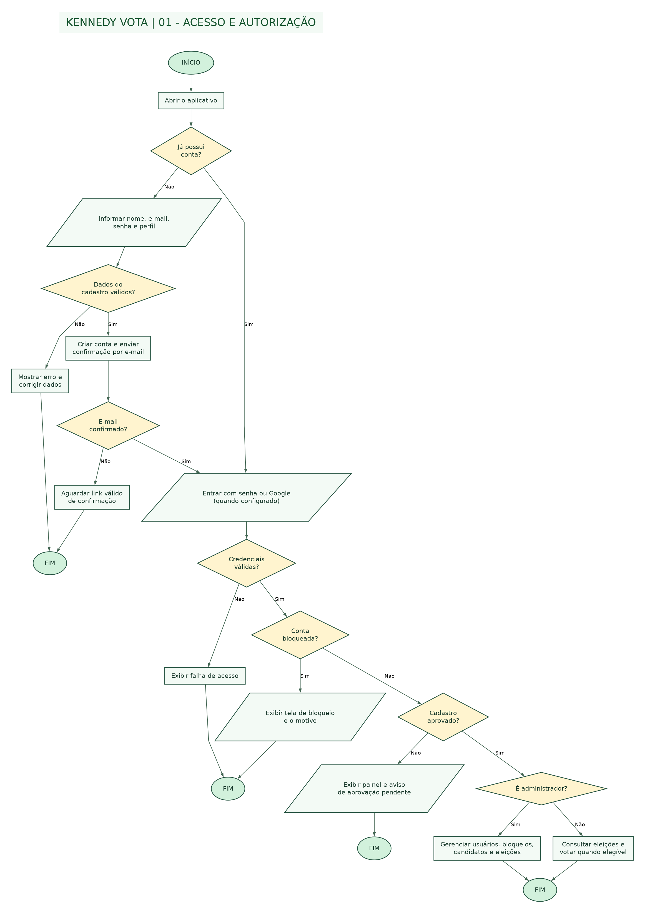
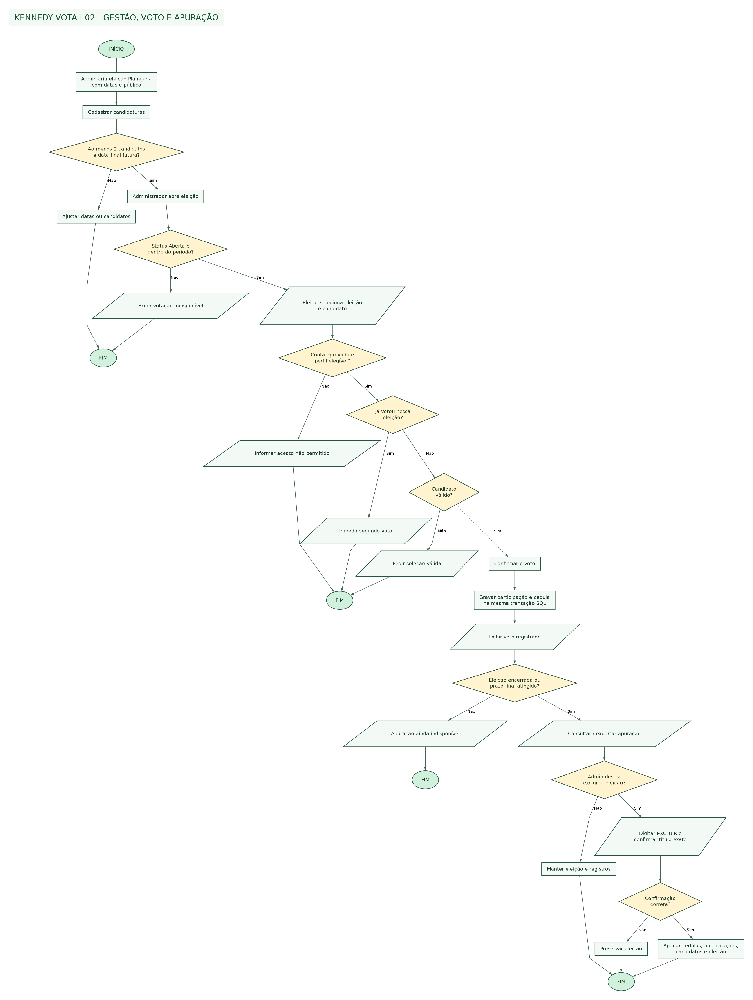

# Fluxogramas padronizados do Kennedy Vota

Dois fluxogramas documentam a **versão da branch de publicação** do sistema escolar experimental.

## 01. Acesso e autorização

[Imagem PNG](01-acesso-e-autorizacao.png) · [Fonte DOT](01-acesso-e-autorizacao.dot)

Abrange cadastro de aluno/professor, validação dos dados, confirmação de e-mail em contas com senha, login (Google somente quando habilitado), bloqueio com motivo, aprovação administrativa e acesso ao portal.

## 02. Gestão, votação e apuração

[Imagem PNG](02-gestao-votacao-apuracao.png) · [Fonte DOT](02-gestao-votacao-apuracao.dot)

Abrange criação da eleição planejada, requisitos de abertura, período válido, elegibilidade, voto único, transação no PostgreSQL, apuração após encerramento e exclusão definitiva apenas com confirmação administrativa.

## Legenda dos símbolos
- **Oval:** início ou fim de um caminho.
- **Retângulo:** processo ou operação.
- **Losango:** decisão com saídas identificadas por “Sim” e “Não”.
- **Paralelogramo:** entrada de dados ou saída exibida ao usuário.
- **Setas:** direção do fluxo.

Os finais distintos representam encerramentos alternativos de um procedimento, e não desligamento da aplicação. A aprovação do primeiro administrador é um procedimento protegido, detalhado em [Arquitetura](../ARQUITETURA.md). O sistema é experimental e não deve ser usado como infraestrutura eleitoral oficial sem auditoria.

As imagens são produzidas automaticamente a partir dos arquivos DOT por [Graphviz](https://graphviz.org/), via GitHub Actions.
